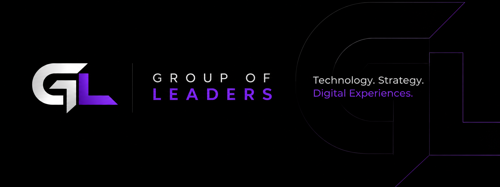

 

**Tecnologia, estratégia e experiências digitais.**

Transformamos ideias em produtos digitais que funcionam, escalam e geram resultado.

 

---

## 🚀 O que fazemos

<table width="100%">
  <tr>
    <td width="60" align="center">🌐</td>
    <td><b>Sites e Landing Pages</b></td>
    <td>Empresas que querem vender e ser encontradas</td>
  </tr>
  <tr>
    <td align="center">⚙️</td>
    <td><b>Sistemas sob medida</b></td>
    <td>Negócios que precisam automatizar processos</td>
  </tr>
  <tr>
    <td align="center">📱</td>
    <td><b>Plataformas e Produtos Digitais</b></td>
    <td>Quem quer tirar uma ideia do papel</td>
  </tr>
</table>

---

## 🧠 Como trabalhamos

`Entender` → `Planejar` → `Desenhar` → `Desenvolver` → `Evoluir`

*Todo projeto começa pelo problema, não pela tecnologia.*

---

## 🛠️ Nossa stack

---

## 📂 Projetos em destaque

<table width="100%">
  <tr>
    <th align="left">Projeto</th>
    <th align="left">O que resolve</th>
    <th align="left">Stack</th>
  </tr>
  <tr>
    <td><a href="https://github.com/Group-of-Leaders/As-Tartarugas"><b>As Tartarugas</b></a></td>
    <td>Uma linha dizendo o que o projeto faz</td>
    <td><code>TypeScript</code></td>
  </tr>
  <tr>
    <td><a href="#"><b>Nome do projeto</b></a></td>
    <td>Uma linha dizendo o que o projeto faz</td>
    <td><code>Next.js</code> <code>Supabase</code></td>
  </tr>
</table>

👉 Veja todos na aba **Repositories**.

---

## 💬 Vamos conversar?

Tem uma ideia, um problema ou um projeto parado? Fale com a gente.

📩 **groupofleaderss@gmail.com**

 

*Building ideas. Creating solutions.*

